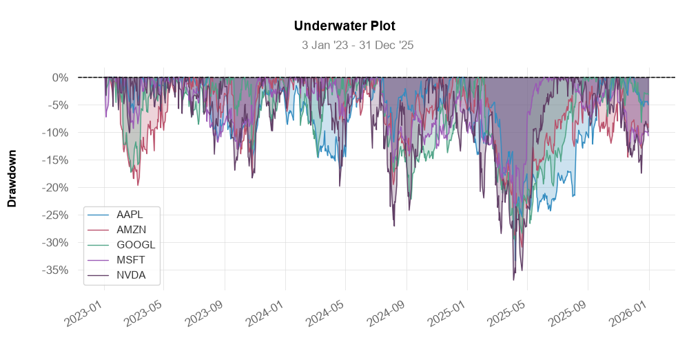

# Market Risk Analysis Tool

A modular Python framework for computing asset-level and portfolio-level market risk metrics.

## Features & Implemented Metrics
- **Risk-Adjusted Performance:** Sharpe Ratio, Sortino Ratio
- **Drawdown Analysis:** Maximum Drawdown (MDD) with Underwater Plot visualization
- **Value at Risk (VaR):** Historical VaR (95%) & Parametric VaR (Normal Distribution)
- **Tail Risk:** Historical Expected Shortfall (CVaR)

## Visualizations
### Underwater Plot
