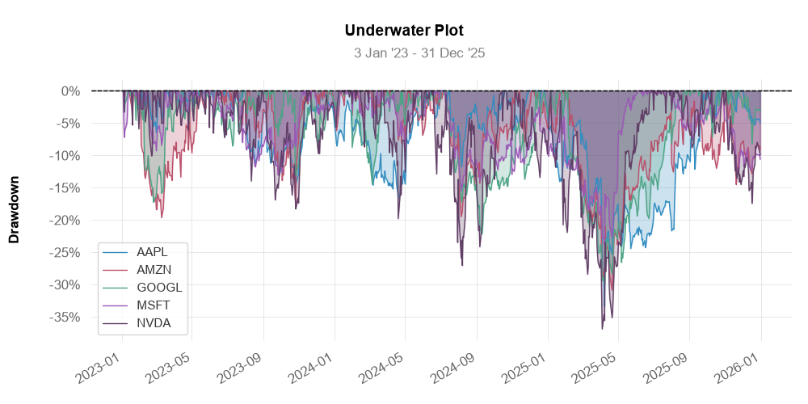
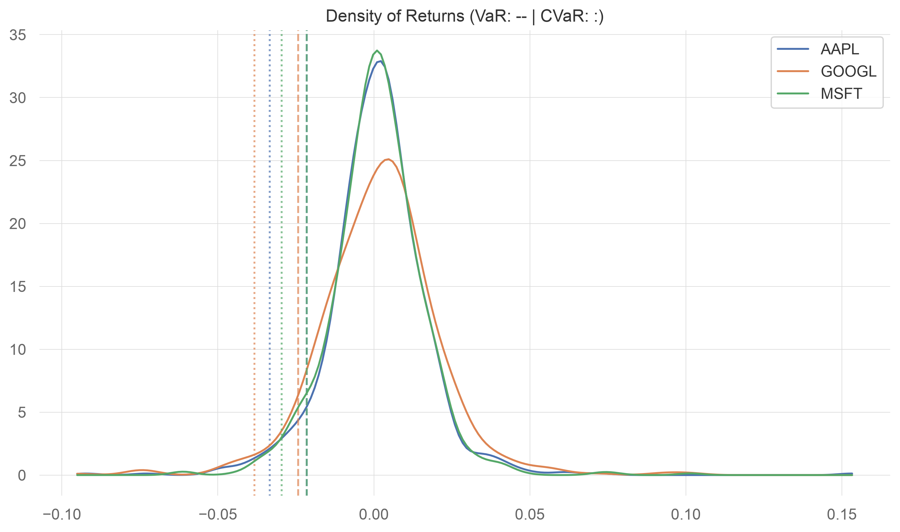
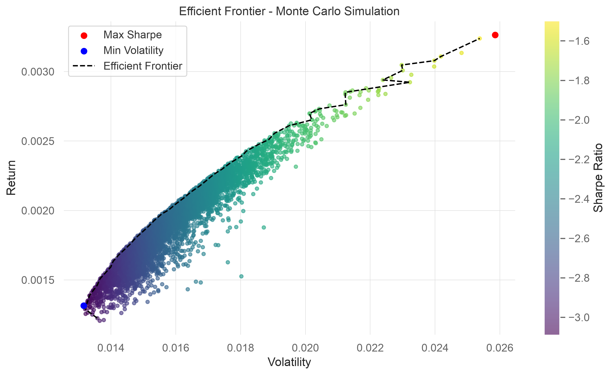

# Market Risk Analysis & Analytics Engine

A modular Python framework and interactive dashboard for computing asset-level and portfolio-level market risk metrics, portfolio optimization, and tail risk visualization.

## 🚀 Interactive Streamlit Dashboard
Run the dashboard locally to analyze custom stock tickers, adjust confidence intervals, and configure portfolio weights in real-time:

```bash
pip install -r requirements.txt
```

## 🖼️ Visualizations

### 🌊 Underwater Plot (Max Drawdown)


### 📉 Return Density & Tail Risk (KDE Plot + VaR & CVaR)


### 🎯 Markowitz Efficient Frontier (Monte Carlo Simulation)
